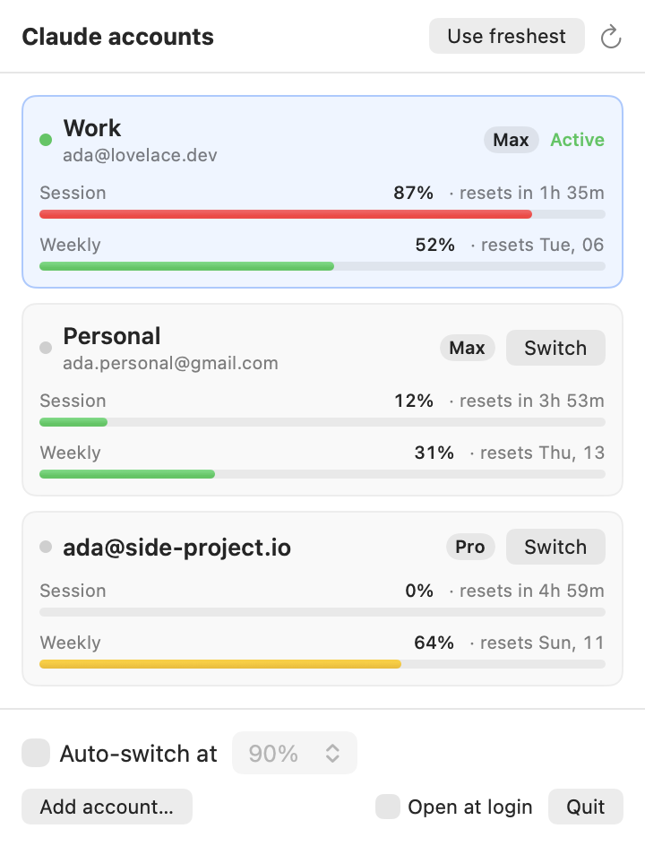

# Claude Switcher

A tiny macOS menu bar app for people who use several Claude subscriptions with **Claude Code**.
It shows each account's session (5‑hour) and weekly limits at a glance and swaps the account
Claude Code is logged in as in one click, so you aren't stuck waiting for a reset.

<p align="center">
  
</p>

- **Usage for every account**: session and weekly percentages with reset countdowns, refreshed every 3 minutes.
- **One-click switch**: the next `claude` you start uses the new account.
- **Zero setup for accounts**: log in to Claude Code once per account and each login is saved automatically.
- **Auto-switch (optional)**: when the active account hits 75–98%, move to the one with the most headroom and get a notification.
- **Menu bar readout**: the active account's tightest limit, e.g. `✳ 42%`.

## Install

**Download:** grab `ClaudeSwitcher.zip` from [Releases](../../releases), unzip, move to Applications.
The build is ad-hoc signed, not notarized, so the first time either right-click → Open, or run:

```sh
xattr -dr com.apple.quarantine /Applications/ClaudeSwitcher.app
```

**From source** (macOS 14+, Xcode or Command Line Tools with Swift 5.9+):

```sh
git clone https://github.com/Sreenivas1323/claude-switcher
cd claude-switcher
./build-app.sh --install   # builds, copies to ~/Applications, launches
```

## Adding accounts

1. Launch the app. Whatever account Claude Code is logged in as now is saved.
2. Click **Add account…** (runs `claude auth login` in Terminal), or run `/login` inside Claude Code, and sign in with the next account.
3. It shows up in the menu within ~10 seconds. Repeat for each account.

Logging in again with an account you already have just refreshes its saved tokens.

## Switching

Click **Switch** on any account, or **Use freshest** to jump to the one with the most headroom.
New `claude` sessions pick it up right away. Sessions that are already running cache their
login, so restart them (or start a new one) to move them over.

## How it works

Claude Code on macOS keeps its login in two places:

| What | Where |
| --- | --- |
| OAuth tokens | Keychain item `Claude Code-credentials`, key `claudeAiOauth` |
| Account profile | `oauthAccount` in `~/.claude.json` |

Claude Switcher:

- **Watches** both every 10 s. When it sees a login it doesn't know (identified via `/api/oauth/profile`), it saves a copy of that account's `claudeAiOauth` tokens into its own keychain items (service `ClaudeSwitcher`) and the profile into `~/Library/Application Support/ClaudeSwitcher/accounts.json`. Because Claude Code rotates tokens as it runs, the saved copy for the active account is kept current.
- **Reads usage** from `GET https://api.anthropic.com/api/oauth/usage`, the endpoint behind Claude Code's `/usage`. Tokens of inactive accounts are refreshed when they near expiry, and the rotated tokens are saved.
- **Switches** by writing the target account's `claudeAiOauth` into Claude Code's keychain item and its `oauthAccount` into `~/.claude.json`. Everything else in both (MCP server logins, settings, project history) stays as it is.

Keychain access goes through `/usr/bin/security`, the same way Claude Code does it, so you won't get keychain permission prompts. Nothing is sent anywhere except Anthropic's own API.

> **Note:** this relies on Claude Code internals (keychain layout, the usage endpoint) that aren't a public API and may change. It is not affiliated with Anthropic. Check that using multiple subscriptions this way fits the terms of your plans.

## Development

```sh
swift build
.build/debug/ClaudeSwitcher                       # run from the terminal
.build/debug/ClaudeSwitcher --demo                # fake accounts, touches nothing
.build/debug/ClaudeSwitcher --demo --snapshot out.png [--dark]   # render the panel to a PNG
```

| File | Purpose |
| --- | --- |
| `ClaudeCode.swift` | Read/write Claude Code's keychain item and `~/.claude.json` |
| `AnthropicAPI.swift` | Usage, profile and token-refresh calls |
| `AccountStore.swift` | Saved accounts (metadata on disk, tokens in keychain) |
| `AppModel.swift` | Sync loop, usage polling, switching, auto-switch |
| `MenuPanel.swift` | The menu bar UI |

## License

MIT
